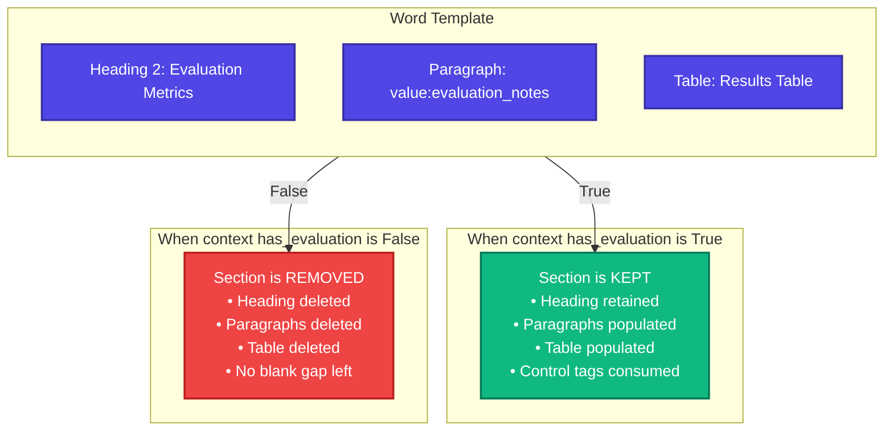

# Conditional Blocks (`if:`)

Conditional blocks allow you to conditionally include or completely remove entire sections of a document—such as an optional appendix, an evaluation summary, or conditional legal disclaimers.

---

## 1. How Conditional Blocks Work



When evaluated:
- **`True`**: The enclosed blocks are retained in the document. Any scalar, row, or image targets inside the block are populated from your input context, and the wrapper control tags are consumed.
- **`False`**: The entire block—including its headings, text, tables, images, and paragraph spacing—is **completely excised** from the document. The surrounding text flows together without awkward empty whitespace or dangling headings.

---

## 2. Authoring Conditional Blocks in Microsoft Word

To wrap a section in an `if:` control in Word:

1. Select the complete set of paragraphs or tables that make up the optional section. (Ensure you select entire paragraphs from start to finish).
2. On the **Developer** tab, click **Rich Text Content Control** (`Aa`).
3. Click **Properties**:
   - Set **Tag** to `if:[boolean_key]`, for example: `if:has_evaluation`.
   - Ensure both **Control cannot be deleted** and **Contents cannot be edited** are **unlocked** (unchecked).
   - Click **OK**.
4. Inside the conditional section, add any normal scalar, table, or picture controls as needed.

---

## 3. Python Data Contract

The context value for an `if:` tag **must be an explicit Python boolean**:

```python
# Condition enabled:
context = {
    "has_evaluation": True,
    "evaluation_notes": "All benchmarks exceeded the 90% accuracy threshold."
}

# Condition disabled:
context = {
    "has_evaluation": False
    # Note: Omit 'evaluation_notes' when False!
}
```

### Strict Boolean Validation
FolioRivet requires an actual boolean (`True` or `False`). Truthy values such as integers (`1` or `0`), non-empty strings (`"true"`), or `None` are **strictly rejected**:

```text
TemplateError: preflight: target="if:has_evaluation", scope=document: expected an explicit boolean
```

---

## 4. Input Rules for Disabled Sections

FolioRivet's bidirectional validation requires you to **omit data keys** belonging to disabled sections:

- When `if:has_evaluation` is `True`, any fields inside it (e.g. `value:evaluation_notes`) **must** be provided in the context.
- When `if:has_evaluation` is `False`, the section is removed. Therefore, if you still pass `"evaluation_notes"` in your context, preflight fails:
  ```text
  TemplateError: preflight: target="value:evaluation_notes", scope=document: missing required target; add this tag to the template or remove the unused input field
  ```

This prevents applications from sending stale or conflicting data for sections that will not appear in the final generated document.

---

## 5. Structural Guarantees & Limitations

1. **Empty Document Protection**:
   If every block in the document happens to be conditional and all conditions evaluate to `False`, FolioRivet automatically inserts a single blank paragraph so the resulting `.docx` remains a structurally valid OpenXML document that Microsoft Word can open without errors.
2. **Top-Level Body Only**:
   Conditional blocks must wrap top-level body paragraphs or tables. They cannot wrap partial lines of text, header/footer elements, or table cells.
3. **No Nesting**:
   An `if:` block cannot contain an inner `if:` block or a `repeat:` block.
