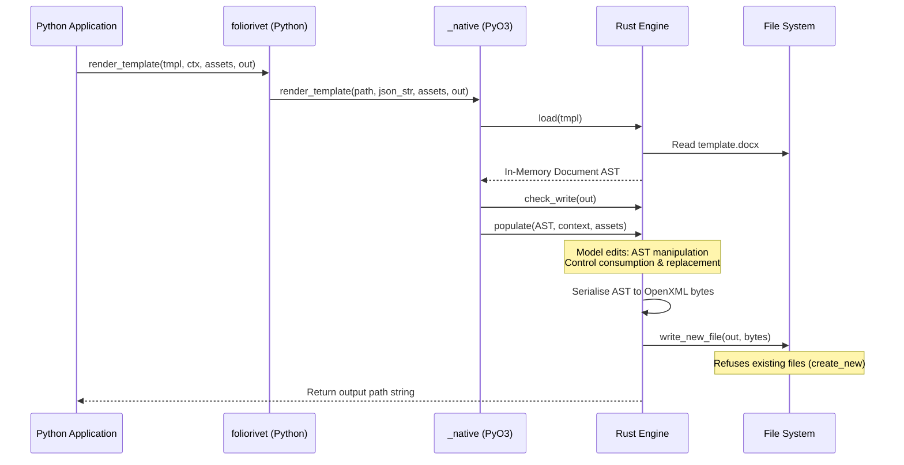

# How FolioRivet Works

FolioRivet is designed around a single guiding philosophy: **predictable, headless, bounded document generation with zero side-effects.**

This page explains how the engine operates internally, how documents are represented and manipulated in memory, the safety bounds enforced, and the atomic guarantees provided during generation.

---

## 1. The Headless Native Architecture

FolioRivet does not automate Microsoft Word through COM/OLE, nor does it spawn LibreOffice processes in headless mode. Instead, all OpenXML parsing, Abstract Syntax Tree (AST) construction, control resolution, and file serialisation occur inside an embedded, high-performance Rust core (`wordcraft_engine`).



### Fresh Session per Render
Every invocation of `render_template` instantiates a brand new document session. The engine loads the template, constructs a clean in-memory document tree, applies the replacements, serialises the output bytes, and immediately tears down the session. There is no background daemon, no shared global state, and no caching between renders that could leak data across requests in multi-tenant environments.

---

## 2. In-Memory Document Model (AST)

Unlike regex or string-replacement engines that treat `.docx` as an opaque collection of raw XML files, FolioRivet parses the document into a strongly-typed Abstract Syntax Tree:

- **Stories**: Documents are partitioned into distinct stories:
  - `StoryRef::Body`: The main narrative flow of the document.
  - `StoryRef::Part`: Header stories (`header1.xml`, `header2.xml`) and footer stories (`footer1.xml`, `footer2.xml`).
- **Blocks**: The body contains structural blocks, primarily **Paragraphs** (`Block::Para`) and **Tables** (`Block::Table`).
- **Inlines**: Paragraphs contain character runs (`Run`), inline images, and **Content Control boundaries** (`InlineObject::ControlStart` and `InlineObject::ControlEnd`).
- **Table Grids & Rows**: Tables contain rows, which contain cells, which contain nested blocks.

Because the engine understands the structural semantics of paragraphs and table rows, it can safely duplicate rows, calculate cell widths, splice block boundaries, and remove entire sections without corrupting the underlying OpenXML hierarchy or introducing dangling XML tags.

---

## 3. Explicit Resource Limits and Bounds

To protect automated server environments from unbounded memory consumption, denial-of-service vectors, or malformed inputs, FolioRivet 0.1.0 enforces strict structural limits:

| Resource | Enforced Limit | Rationale & Protection |
|:---|:---|:---|
| **Context JSON Size** | `1,048,576` bytes (1 MiB) | Prevents runaway memory allocation during parsing. |
| **Context Nesting Depth** | `32` levels | Guard against recursive JSON payloads and stack exhaustion. |
| **Scalar Replacement Size** | `65,536` bytes (64 KiB) UTF-8 | Ensures individual field replacements remain reasonable. |
| **Tagged Document Targets** | `1024` targets max | Caps total control resolution complexity per document. |
| **Repeated Table Rows** | `1000` rows total | Bounds table layout and serialisation budget. |
| **Repeated Block Items** | `1000` items total | Caps total section expansion in `repeat:` blocks. |
| **Serialized Expansion Budget** | `16` MiB total | Restricts aggregate memory footprint of duplicated AST prototypes. |
| **Image Asset File Size** | `16` MiB per file | Prevents loading massive raw image assets from disk. |
| **Image Asset Decoding Budget** | `64` MiB memory | Limits decoded raster decompression (pixel bomb protection). |
| **Field Path Length** | `256` bytes max | Bounds dotted ASCII identifier lengths. |

> [!NOTE]
> These bounds represent explicit structural guardrails for 0.1.0 public preview. They are not performance bottlenecks; for typical document generation (reports of 1–100 pages), real payloads rarely exceed a fraction of these limits.

---

## 4. Atomic Staging and Overwrite Refusal

Document generation failures in production often leave partially written, corrupted files on disk. FolioRivet prevents this through strict write semantics:

1. **Pre-flight Write Check**: Before running heavy document manipulation, the output path is validated via `check_write`. It verifies that the path is not empty, does not target reserved OS device names (`CON`, `PRN`, `AUX`, `NUL` on Windows), and is accessible.
2. **In-Memory Preparation**: All template manipulation is performed on an in-memory document clone. If an error occurs midway through populating rows or decoding an image, the operation aborts immediately and raises `TemplateError`. The original template and disk remain untouched.
3. **Atomic File Creation**: Output bytes are written using `create_new(true)`. If a file already exists at `output_path`, the OS refuses the write immediately.
4. **Clean Staging Requirement**: The target file must be new, and its parent folder must already exist.

```python
# Recommended production pattern:
from pathlib import Path
from foliorivet import render_template

output_file = Path("staging/job-842.docx")
output_file.parent.mkdir(parents=True, exist_ok=True)

# Generate to staging
render_template(template, data, assets_dir, output_file)

# Move/publish only after successful generation
output_file.replace("published/final-report.docx")
```

---

## 5. Separation of Concerns: Python vs Rust

A critical design choice in FolioRivet is the strict division of responsibility:

- **What Rust does**: Fast, safe OpenXML reading, control resolution, AST validation, structure replication, image decoding/scaling, and serialisation.
- **What Python does**: Data fetching, business calculations (totals, taxes, percentages), data formatting (dates, currency strings, number formatting), and asset management.

FolioRivet does not contain an embedded expression language or template scripting engine. By keeping document generation declarative and deterministic, your templates stay clean, readable by non-developers in Word, and free of hidden template-level bugs.
