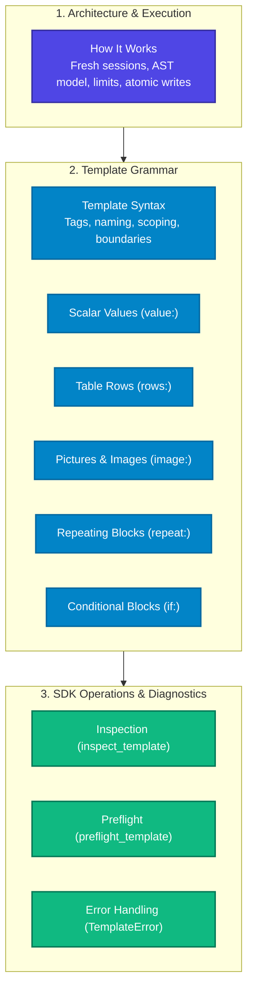

# Concepts Overview

This section covers the core concepts, architecture, and authoring rules that govern FolioRivet 0.1.0.

Understanding these concepts will help you design reliable templates, write clean Python integration code, and take advantage of FolioRivet's fail-fast validation model.

---

---

## Conceptual Guides

### 1. Engine Architecture
- **[How It Works](how-it-works.md)**: Explore the headless document session model, AST representation, resource budgets, and atomic staging guarantees.

### 2. Template Syntax and Operations
- **[Template Syntax](template-syntax.md)**: The authoritative syntax grammar, Word control requirements, naming rules, and scoping conventions.
- **[Scalar Values](scalar-values.md)**: In-depth guide to `value:` replacements, type conversions, multiline rules, and styling preservation.
- **[Table Rows](table-rows.md)**: How `rows:` prototype expansion works, handling empty lists, formatting constraints, and `value:item.*` addressing.
- **[Pictures & Images](pictures.md)**: Authoring `image:` picture controls, aspect-ratio fitting, required assets, and graceful fallback text.
- **[Repeating Blocks](repeating-blocks.md)**: Multi-paragraph and multi-table section repetition with `repeat:`.
- **[Conditional Blocks](conditional-blocks.md)**: Including and removing complete logical sections with `if:` booleans.

### 3. Inspection, Preflight & Diagnostics
- **[Inspection](inspection.md)**: Discovering declared targets and checking template health before running any business logic.
- **[Preflight](preflight.md)**: Comprehensive schema, limit, and asset validation prior to document mutation.
- **[Error Handling](error-handling.md)**: Diagnostic anatomy of `TemplateError`, failure recovery patterns, and operation scopes.
