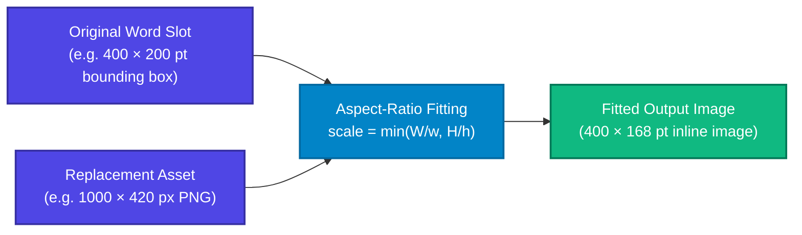

# Pictures & Images (`image:`)

FolioRivet provides native image replacement for charts, diagrams, logos, and signatures through the `image:` operation.

Unlike simple macro scripts that disrupt document flow, FolioRivet replaces an existing inline picture slot while strictly preserving the designer's bounding box, aspect ratio, and surrounding text alignment.

---

## 1. How Image Replacement Works



1. **Bounding Box Calculation**: The template author places an inline image in Microsoft Word. That image's physical width and height define the **maximum bounding box**.
2. **Probing and Decoding**: When generating or preflighting, FolioRivet inspects the incoming raster image, decodes it into memory (within a 64 MiB budget), and obtains its natural pixel dimensions.
3. **Proportional Scaling**: The engine scales the new image so that it fits entirely within the original bounding box while preserving its exact aspect ratio:
   $$\text{scale} = \min\left(\frac{W_{\text{slot}}}{W_{\text{new}}}, \frac{H_{\text{slot}}}{H_{\text{new}}}\right)$$
4. **Media Embedding**: The image binary is added to the `.docx` OpenXML media package (`word/media/`), and the drawing reference is updated.

---

## 2. Authoring Picture Targets in Microsoft Word

Follow these steps to create an image replacement slot in Word:

1. Insert a placeholder image:
   - Click **Insert** > **Pictures** > **This Device...**
   - Insert any temporary PNG or JPEG image (e.g. a placeholder box or draft chart).
2. Set text wrapping:
   - Ensure the picture wrapping is set to **In Line with Text** (the default in Word). Floating images (such as *Square*, *Tight*, or *Behind Text*) are **not supported** for replacement slots.
3. Size the placeholder:
   - Use Word's sizing handles or the **Picture Format** tab to size the placeholder to your desired maximum dimensions on the page.
   - Ensure the picture is **uncropped** (no crop margins applied).
4. Wrap in a Picture Content Control:
   - Select the image.
   - Go to the **Developer** tab and click the **Picture Content Control** icon.
5. Set properties:
   - Click **Properties**.
   - Set **Tag** to `image:[field_name]`, for example: `image:performance_chart`.
   - Ensure **Contents cannot be edited** is **unlocked**.
   - Click **OK**.

---

## 3. Python Data Contract

The context value for an `image:` tag must be a **dictionary** describing the asset.

### Required Image Asset

To populate a mandatory image from disk:

```python
context = {
    "performance_chart": {
        "path": "charts/monthly_performance.png",
        "required": True  # Optional; defaults to True
    }
}
```

- `path`: A relative path from the `assets_dir` supplied to `render_template` or `preflight_template`.
- Paths must use **forward slashes** (`/`), cannot contain backslashes (`\`), drive prefixes (`C:`), or directory traversal components (`..`).

### Optional Image with Fallback Text

If an image is optional and not generated for a given run (for example, if a model evaluation produced no chart), you can explicitly omit it by supplying `path: None` and providing replacement fallback text:

```python
context = {
    "performance_chart": {
        "path": None,
        "required": False,
        "unavailable": "Performance chart was not generated for this billing cycle."
    }
}
```

When `path` is `None` and `required` is `False`:
- FolioRivet removes the picture control from the document.
- It inserts the string from `"unavailable"` in its place inside the same paragraph.
- The fallback text inherits the paragraph's typography and font formatting.

> [!WARNING]
> **Missing Files Never Silently Disappear**
> If you specify `"path": "chart.png"`, FolioRivet requires the file to exist on disk. If the file is missing, rendering fails immediately—even if `"required": False`. To omit an image, you must explicitly pass `"path": None`.

---

## 4. Asset Directory Resolution (`assets_dir`)

When calling `render_template` or `preflight_template`, pass the root folder where image assets reside:

```python
render_template(
    template_path="templates/report.docx",
    context_json=context,
    assets_dir="generated_charts",
    output_path="staging/report.docx"
)
```

### Path Traversal Protection
FolioRivet canonicalises both `assets_dir` and the relative asset path before loading. If an asset path resolves outside `assets_dir` (for example via symlinks or relative references), the engine rejects the operation:

```text
TemplateError: preflight: target="image:chart", scope=document: asset must remain inside assets_dir after resolving links
```

---

## 5. Supported Image Formats and Limits

- **Supported Formats**: Raster images (**PNG** and **JPEG**).
- **Unsupported Formats**: SVG, EMF/WMF vector metafiles, OLE embedded objects, TIFF, and WebP are not supported in 0.1.0 image replacement slots.
- **File Size Limit**: Up to 16 MiB per image file.
- **Decompression Limit**: Images that decode into more than 64 MiB of raw raster memory are rejected.
- **Maximum Dimensions**: Target slots must have finite dimensions up to 22 inches (1,584 points).
