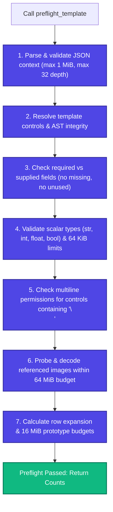

# Preflight (`preflight_template`)

FolioRivet provides a dedicated validation phase called **Preflight**. Preflight verifies your input data, structural constraints, and referenced image assets against a template *before* any output file is created.

---

## 1. Why Run Preflight?

In document generation workflows, errors caught during rendering can lead to partial staging files, wasted processing time, and broken asynchronous pipelines.

`preflight_template` acts as a dry-run gatekeeper:

- **Strict Schema Validation**: Verifies that every required target receives valid data and that no unexpected keys were supplied.
- **Asset Integrity**: Resolves, reads, probes, and decodes image files into memory to guarantee they are uncorrupted before rendering.
- **Resource Budget Enforcement**: Confirms that string lengths, row counts, and block expansion budgets remain within safety limits.
- **Zero Side Effects**: Preflight never writes to the filesystem or mutates the template.

---

## 2. Using `preflight_template`

```python
from pathlib import Path
from foliorivet import preflight_template, TemplateError

template = Path("templates/invoice.docx")
data = {
    "customer": "Apex Global",
    "quote_id": "Q-2026-99",
    "lines": [
        {"description": "Design Audit", "quantity": 1, "unit_price": "£500", "amount": "£500"},
        {"description": "Sprint Delivery", "quantity": 3, "unit_price": "£1,200", "amount": "£3,600"}
    ],
    "subtotal": "£4,100",
    "tax": "£820",
    "total": "£4,920"
}

try:
    summary = preflight_template(template, data)
    print("Preflight Summary:")
    for key, value in summary.items():
        print(f"  • {key}: {value}")
except TemplateError as err:
    print(f"Preflight validation failed: {err}")
```

### Example Preflight Summary

Depending on the template features used, `preflight_template` returns a structured dictionary:

```json
{
  "scalar_count": 5,
  "row_count": 2,
  "image_count": 0,
  "repeated_items": 0,
  "included_optional_blocks": 0,
  "save_verified": false
}
```

---

## 3. Summary Field Reference

| Field | Type | Description |
|:---|:---|:---|
| `scalar_count` | `int` | Total number of scalar replacements (`value:`) validated. |
| `row_count` | `int` | Total number of table rows to be generated across all `rows:` tables. |
| `image_count` | `int` | Total number of picture slots (`image:`) validated. |
| `repeated_items` | `int` | Total number of block items to be expanded in `repeat:` blocks. |
| `included_optional_blocks` | `int` | Number of `if:` blocks evaluated to `True`. |
| `save_verified` | `bool` | **Always `false`**. Preflight executes in-memory and does not verify filesystem write permissions or disk space. |

> [!NOTE]
> **Why `save_verified` is Always False**
> Preflight validates data, schema, and image decodability. It does not touch the destination path on disk. Filesystem access, write permissions, and disk space are validated only during `render_template`.

---

## 4. What Preflight Checks

When you call `preflight_template`, the engine executes the following checks:



If any check fails, preflight raises a descriptive `TemplateError` detailing the operation, target, and root cause.

---

## 5. Inspection vs Preflight vs Rendering

To understand where each SDK call fits in your application lifecycle:

| Feature | `inspect_template` | `preflight_template` | `render_template` |
|:---|:---:|:---:|:---:|
| **Requires Template Path** | Yes | Yes | Yes |
| **Requires Input Data Context** | No | Yes | Yes |
| **Requires `assets_dir`** | No | Yes (if images used) | Yes (if images used) |
| **Requires Output Destination Path** | No | No | Yes |
| **Decodes Images into Memory** | No | Yes | Yes |
| **Writes Output File to Disk** | No | No | **Yes** |
| **Typical Execution Time** | < 5 ms | 5–25 ms | 10–50 ms |
| **Recommended Usage** | Template upload, CI/CD | Form validation, background jobs | Final document emission |
