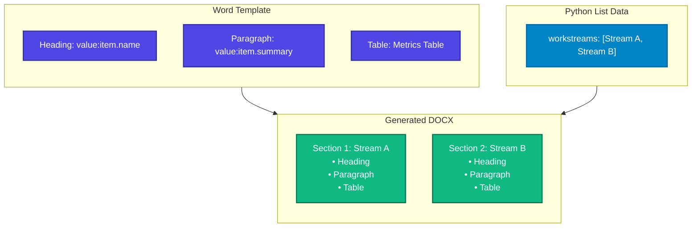

# Repeating Blocks (`repeat:`)

While `rows:` duplicates rows within a single table, `repeat:` repeats entire **multi-paragraph and multi-element sections**—such as project workstreams, class assessment profiles, or multi-page product summaries.

---

## 1. How Repeating Blocks Work



When FolioRivet encounters a `repeat:[name]` block:
1. It validates the enclosed block prototype against your Python input list.
2. It duplicates all enclosed structural blocks (paragraphs, headings, callout boxes, tables, and image slots) once for every item in the list.
3. For each iteration, it populates the scoped fields (e.g. `value:item.*`).
4. It consumes the wrapper control tags, leaving seamless, ordinary Word document sections.

---

## 2. Authoring a Repeating Block in Microsoft Word

Follow these steps to wrap a document section:

1. In Microsoft Word, draft the complete prototype section:
   - For example: a Heading 2, a descriptive paragraph, a summary table, and a chart placeholder.
2. Select the entire section:
   - Highlight from the start of the first paragraph through to the end of the last paragraph or table in the section.
   - Ensure you select **entire paragraphs** (include the trailing paragraph marks).
3. On the **Developer** tab, click **Rich Text Content Control** (`Aa`).
   - *Note*: Ensure it creates a **block-level** control wrapping the paragraphs, rather than an inline control.
4. Click **Properties**:
   - Set **Tag** to `repeat:[name]`, e.g. `repeat:workstreams`.
   - Ensure both **Control cannot be deleted** and **Contents cannot be edited** are **unlocked** (unchecked).
   - Click **OK**.
5. Configure fields inside the block:
   - Inside the heading: insert a Plain Text control tagged `value:item.name`.
   - Inside paragraphs: insert Plain Text controls tagged `value:item.[field]`.
   - Inside tables: if a table repeats rows, insert a row tagged `rows:[nested_list]` with cells tagged `value:item.[column]`.
   - Inside picture slots: tag with `image:[nested_image]`.

> [!IMPORTANT]
> **Field Scoping Rule**
> Every scalar field within a `repeat:` block must use the `value:item.` prefix. Top-level tags like `value:name` are rejected inside a repeated block prototype.

---

## 3. Python Data Contract

The context field matching the `repeat:` tag must be a **list of dictionaries**:

```python
context = {
    "workstreams": [
        {
            "name": "Data Ingestion Pipeline",
            "lead": "Marcus Vance",
            "progress": "85%",
            "notes": "Ahead of schedule."
        },
        {
            "name": "Model Governance Review",
            "lead": "Sarah Jenkins",
            "progress": "40%",
            "notes": "Pending compliance sign-off."
        }
    ]
}
```

### Empty Lists
If an empty list (`[]`) is passed for a `repeat:` target:
- The entire prototype block (all headings, paragraphs, and tables inside it) is **completely removed** from the output document.
- Surrounding document content before and after the block shifts up cleanly.

---

## 4. Supported Features Inside Repeating Blocks

Inside a `repeat:` block, you may freely combine:

- **Multiple Paragraphs**: Headings, body text, lists, and quotes.
- **Nested `rows:` Tables**: Tables with repeating rows that resolve arrays from the current item object (e.g. `item["tasks"]`).
- **Nested `image:` Slots**: Picture slots that load assets specified in the current item object (e.g. `item["chart"]`).

---

## 5. Structural Constraints & Limitations

To guarantee predictable layout and prevent document corruption, FolioRivet 0.1.0 enforces:

1. **Top-Level Body Only**:
   Repeating blocks must reside in the main document body (`StoryRef::Body`). They cannot be placed in headers, footers, footnotes, or inside table cells.
2. **No Nested Variable Blocks**:
   A `repeat:` block cannot enclose another `repeat:` or an `if:` block.
3. **No Section Breaks Inside Blocks**:
   A repeating block cannot contain a physical Word Section Break (`w:sectPr` page or column breaks that alter page margins or orientation).
4. **No Tracked Changes or Bookmarks**:
   Tracked changes (`w:ins`, `w:del`) and bookmarks are unsupported inside repeated prototypes because duplicating them creates invalid, duplicated bookmark IDs in OpenXML.
5. **Budgets and Bounds**:
   Up to 1,000 repeated items and 16 MiB of combined serialized block data are permitted per document.
