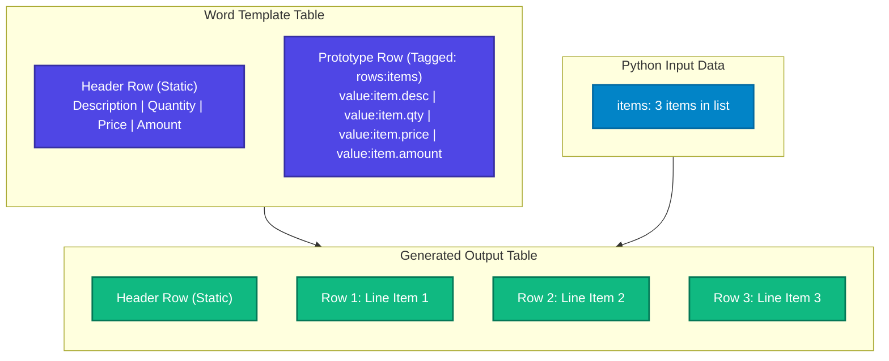

# Table Rows (`rows:`)

Dynamic tables—such as invoice line items, class schedules, or transaction lists—are generated using FolioRivet's `rows:` operation.

Instead of writing complex table-drawing code, you design a single "prototype row" directly inside a Word table, and FolioRivet expands that row for every item in your Python list.

---

## 1. How Table Row Repetition Works



When rendering:
1. FolioRivet locates the row wrapped with `rows:[name]`.
2. It validates the prototype against the items in your Python list.
3. It clones the row's geometry, borders, background shading, and cell widths for each item.
4. It populates each cell's `value:item.*` tags with the corresponding item data.
5. It consumes (removes) the temporary content control tags, leaving ordinary editable Word table rows.

---

## 2. Authoring a Repeating Row in Microsoft Word

Follow these exact steps in Microsoft Word:

### Step A: Create the Table Structure
1. Insert a table with at least **two rows**:
   - **Row 1**: Header row with static column titles (e.g., *Description*, *Qty*, *Price*, *Total*).
   - **Row 2**: Data prototype row.

### Step B: Wrap the Row in a Content Control
1. Select the **entire second row**. (Click in the margin just to the left of the row, or highlight all cells across the row).
2. Go to the **Developer** tab and click **Rich Text Content Control** (`Aa`).
3. Click **Properties**.
4. Set:
   - **Title**: `Line Items`
   - **Tag**: `rows:line_items`
   - **Locking**: Ensure both **Control cannot be deleted** and **Contents cannot be edited** are **UNCHECKED**.
5. Click **OK**.

### Step C: Tag the Cell Fields
Inside each cell of your prototype row, insert Content Controls for the columns:

- In Cell 1 (Description): Insert a Plain Text control tagged `value:item.description`.
- In Cell 2 (Quantity): Insert a Plain Text control tagged `value:item.quantity`.
- In Cell 3 (Unit Price): Insert a Plain Text control tagged `value:item.unit_price`.
- In Cell 4 (Total Amount): Insert a Plain Text control tagged `value:item.amount`.

> [!IMPORTANT]
> **The `value:item.` Prefix is Mandatory**
> All scalar fields inside a repeating row prototype **must** begin with `value:item.`. If you use `value:description` instead of `value:item.description`, preflight will reject the template.

---

## 3. Python Data Contract

The context field referenced by the `rows:` tag must be a **list of dictionaries**:

```python
context = {
    "line_items": [
        {
            "description": "Standard Support Package",
            "quantity": 1,
            "unit_price": "£250.00",
            "amount": "£250.00"
        },
        {
            "description": "Custom Integration Workshop",
            "quantity": 2,
            "unit_price": "£600.00",
            "amount": "£1,200.00"
        }
    ]
}
```

### Handling Different List Sizes

- **Multiple Items**: The prototype row is duplicated once for each dictionary in the list.
- **One Item**: The prototype row is populated in-place.
- **Zero Items (Empty List `[]`)**: The prototype row is cleanly removed from the table. The static header row remains.
- **Null / Non-List Value**: If you provide `None`, a string, or an object instead of a list, preflight raises:
  ```text
  TemplateError: preflight: target="rows:line_items", scope=document: expected an array of item objects
  ```

---

## 4. Structural Restrictions & Limitations

To ensure table fidelity without risking OpenXML table grid corruption, FolioRivet 0.1.0 enforces several table constraints:

1. **Static Header Row Required**:
   A table cannot consist solely of a `rows:` prototype row. There must be at least one other static row (such as a header row or footer row) so that if the list is empty (`[]`), the table remains valid.
2. **No Vertical Merges**:
   Vertical cell merges (`w:vMerge`) anywhere in a table containing a `rows:` prototype are unsupported. (Horizontal column spans via `gridSpan` are supported).
3. **No Cell-Level Control Wrappers**:
   Do not wrap individual cells in content controls. Wrap either the entire row (`rows:`) or inline text runs inside cells (`value:item.*`).
4. **No Nested Tables**:
   Prototype rows cannot contain nested tables.
5. **Row Limit**:
   Up to 1,000 total data rows can be expanded across the entire document.
