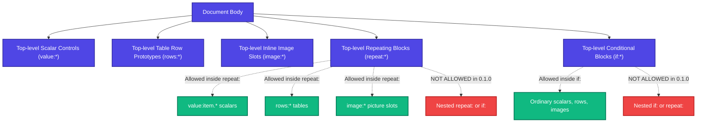

# Template Syntax

This page provides the authoritative specification for authoring Microsoft Word templates for FolioRivet 0.1.0.

---

## 1. Syntax Overview

FolioRivet identifies template targets through the **Tag** property of Microsoft Word Content Controls (`w:sdt`).

Each tag begins with an operation prefix followed by a colon and a dotted identifier:

```text
[prefix]:[path.to.field]
```

### Supported Operation Prefixes

| Prefix | Meaning | Target Element | Scope |
|:---|:---|:---|:---|
| `value:` | Scalar value replacement | Plain Text or Rich Text control | Inline (within one paragraph) |
| `rows:` | Repeating table row prototype | Rich Text control wrapping a single `w:tr` | Table row level |
| `image:` | Inline picture replacement | Picture Content Control wrapping an inline image | Inline image slot |
| `repeat:` | Repeating body block prototype | Rich Text control wrapping complete blocks | Block level (top-level body) |
| `if:` | Conditional section inclusion/removal | Rich Text control wrapping complete blocks | Block level (top-level body) |

---

## 2. Naming Conventions and Identifiers

The field path following the prefix must adhere to strict naming conventions:

- **Character Set**: Dotted ASCII path. Segments must contain only alphanumeric ASCII characters (`a-z`, `A-Z`, `0-9`) and underscores (`_`).
- **Segment Length**: Each segment separated by `.` must be non-empty.
- **Maximum Length**: The entire path string must not exceed 256 bytes.
- **Examples of Valid Tags**:
  - `value:customer_name`
  - `value:invoice.header.date`
  - `rows:line_items`
  - `image:charts.performance_graph`
  - `repeat:project_milestones`
  - `if:include_executive_summary`
- **Examples of Invalid Tags**:
  - `value:customer-name` (hyphens not permitted; use underscores)
  - `value:customer name` (spaces not permitted)
  - `value:data..item` (empty segment between consecutive dots)
  - `value:café` (non-ASCII characters in key paths; values themselves can be any Unicode string, but keys must be ASCII)

---

## 3. Microsoft Word Content Control Requirements

When creating controls in Microsoft Word:

### Title vs Tag
Word Content Controls possess both a **Title** (`w:alias`) and a **Tag** (`w:tag`).
- **Tag**: **Authoritative.** FolioRivet matches targets strictly against the `Tag` attribute.
- **Title**: Informational only. Word displays the Title in the user interface when the control is clicked. FolioRivet's resolver does not use the Title for data binding.

### Control Locking
Word offers two locking checkboxes under Content Control Properties:
1. *Control cannot be deleted*: If checked, the control boundary cannot be removed.
2. *Contents cannot be edited*: If checked, the text within the control cannot be altered.

> [!WARNING]
> **Ensure Controls are Unlocked**
> For all `value:`, `rows:`, `image:`, `repeat:`, and `if:` controls, **Contents cannot be edited** must be **unlocked** (unchecked).
> For `rows:`, `repeat:`, and `if:` blocks that are consumed during generation, **Control cannot be deleted** must also be **unlocked**.
> If an edit-locked control is encountered during preflight or rendering, FolioRivet raises a `TemplateError`.

---

## 4. Uniqueness and Scoping Rules

### Document-Level Uniqueness
At the top level of the document, **all tags must be unique**. If two controls in the document body, headers, or footers share the exact same tag (for example, two controls tagged `value:order_id`), the resolver rejects the template as ambiguous:

```text
TemplateError: resolve: target="value:order_id", scope=document: ambiguous target; tags must be unique across document stories
```

### Scoped Addressing with `value:item.*`
When controls reside inside a repeated prototype—either a repeated table row (`rows:`) or a repeated block (`repeat:`)—their scalar targets are resolved relative to the individual item in the array.

Inside any repeating scope, all scalar controls **must** begin with `value:item.`:

```text
# Valid inside rows:items or repeat:milestones:
value:item.title
value:item.score
value:item.date

# Invalid inside a repeating scope (will cause preflight error):
value:title
```

Because fields inside repeated items are evaluated in the scope of each item, two different repeating tables may safely use the same item field names (e.g. `value:item.name` in a attendees table and `value:item.name` in a speakers table).

---

## 5. Structural Constraints and Nesting

To maintain deterministic layout and avoid corrupting Word's XML hierarchy, FolioRivet 0.1.0 enforces bounded structural rules:



1. **Nested Variable Blocks Are Unsupported**:
   A `repeat:` block cannot contain an inner `repeat:` or `if:` block. Similarly, an `if:` block cannot contain a `repeat:` or inner `if:` block.
2. **Whole Block Boundaries**:
   Block controls (`repeat:` and `if:`) must wrap entire paragraphs or entire tables. They cannot start halfway through one paragraph and end in another.
3. **Table Row Prototypes**:
   A `rows:` control must wrap exactly one non-header data row in a table. The table must have at least one other row (such as a header row) that is not part of the prototype.
4. **No Vertical Merges in Repeated Tables**:
   Vertical cell merges (`w:vMerge`) anywhere in a table targeted by `rows:` are unsupported.

---

## 6. Copy-Paste Syntax Reference

| Operation | Word Control | Example Tag | Expected Python Input | Output Behavior |
|:---|:---|:---|:---|:---|
| **Scalar Replacement** | Plain Text or Rich Text | `value:client.name` | `"Acme Corp"` or `123` | Replaces control text in place. Formatting of the first character is preserved. |
| **Table Row Prototype** | Rich Text wrapping single row | `rows:line_items` | `[{"description": "...", "amount": "..."}]` | Duplicates row for each array item. Replaces inner `value:item.*` tags. If array is empty, removes prototype row. |
| **Required Picture** | Picture Control | `image:company_logo` | `{"path": "images/logo.png"}` | Scales image to fit original slot bounding box, preserving aspect ratio. |
| **Optional Picture** | Picture Control | `image:audit_chart` | `{"path": null, "required": false, "unavailable": "Chart unavailable"}` | Replaces picture slot with the provided fallback text in the same run style. |
| **Repeating Block** | Rich Text wrapping paragraphs/tables | `repeat:workstreams` | `[{"name": "...", "status": "..."}]` | Duplicates all enclosed blocks for each item. Replaces inner `value:item.*` tags. |
| **Conditional Block** | Rich Text wrapping paragraphs/tables | `if:show_appendix` | `True` or `False` | When `True`, keeps content and populates nested targets. When `False`, completely removes all enclosed blocks. |
