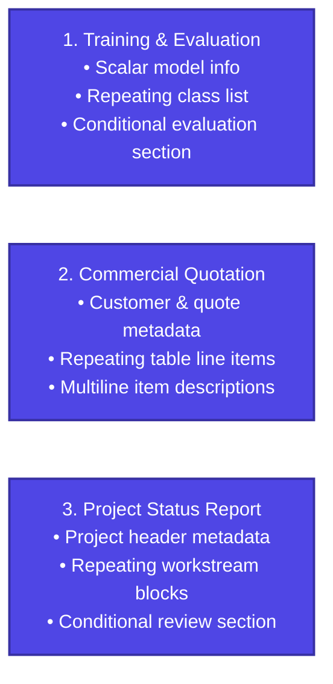

# Example Tutorials

FolioRivet includes three official, redistributable reference examples demonstrating bounded template operations in real-world scenarios.

All examples use original synthetic content, layout, and minimal OpenXML authored specifically for FolioRivet under MIT OR Apache-2.0. No proprietary assets or third-party templates are required.

---

## The Three Official Example Families

---

## Example Summaries

### 1. [Training & Evaluation Report](training-evaluation.md)
- **Business Scenario**: Machine learning model qualification report.
- **Operations Used**: `value:model`, `repeat:classes`, `value:item.name`, `value:item.precision`, `if:has_evaluation`, `value:evaluation`.
- **Key Concepts**: Repeating multi-block sections, scoping scalar tags within repeated items, and conditionally removing an entire evaluation appendix.
- **Source Location**: `bindings/python/examples/training-evaluation/`

### 2. [Commercial Quotation & Invoice](invoice.md)
- **Business Scenario**: Client service quotation and billing invoice.
- **Operations Used**: `value:customer`, `value:quote_id`, `rows:lines`, `value:item.description`, `value:item.quantity`, `value:item.unit_price`, `value:item.amount`, `value:subtotal`, `value:tax`, `value:total`.
- **Key Concepts**: Dynamic table row repetition, preserving table borders and cell geometry, multiline descriptions inside table cells, and precomputing financial totals in Python.
- **Source Location**: `bindings/python/examples/invoice/`

### 3. [Project Status Report](project-status.md)
- **Business Scenario**: Executive project progress and workstream health summary.
- **Operations Used**: `value:project_name`, `repeat:workstreams`, `value:item.name`, `value:item.progress`, `if:has_review`.
- **Key Concepts**: Repeating multi-block sections containing nested status tables, maintaining typography across repeated sections, and conditionally including executive review notes.
- **Source Location**: `bindings/python/examples/project-status/`

---

## Practical Recipes

Looking for quick copy-paste snippets for common tasks? Check out the **[Practical Recipes](recipes.md)** page:
- Safe rendering with automatic directory creation and overwrite protection.
- Dynamic form and schema generation using `inspect_template`.
- Optional chart replacement with fallback text.
- Batch document processing with error isolation.
- Integration with Pydantic models.
