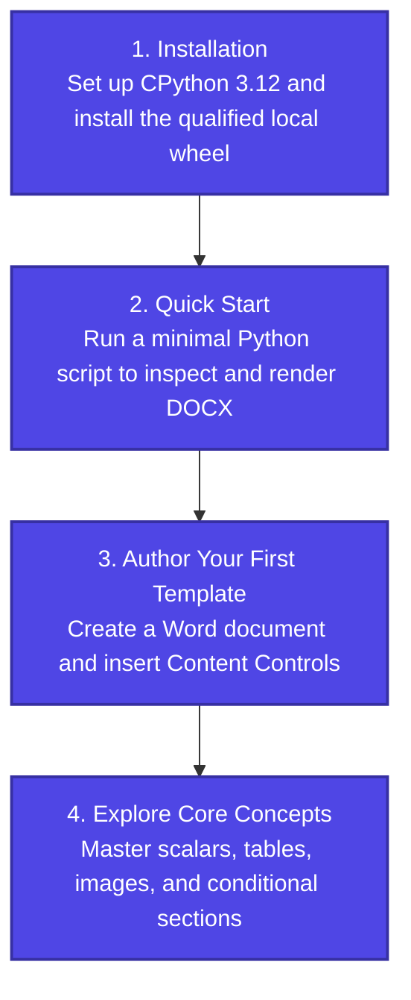

# Getting Started with FolioRivet

Welcome to the FolioRivet getting started guide. This section will guide you through setting up your Python environment, installing the native 0.1.0a1 distribution, running your first generation workflow, and authoring a Word template from scratch.

---

## The Learning Path

---

## Guides in this Section

1. **[Installation Guide](installation.md)**:
   Requirements, platform support (Windows x64 and Ubuntu 22.04 x64), virtual environment setup, installing qualified local wheels, verification, and common installation troubleshooting.

2. **[Quick Start](quickstart.md)**:
   A self-contained 5-minute walkthrough demonstrating how to inspect a template, validate input data with preflight, and render a new DOCX file using Python.

3. **[Your First Word Template](first-template.md)**:
   A step-by-step authoring tutorial showing how to open Microsoft Word, enable the Developer tab, configure Plain Text and Rich Text Content Controls with tags, and save a template ready for FolioRivet.
