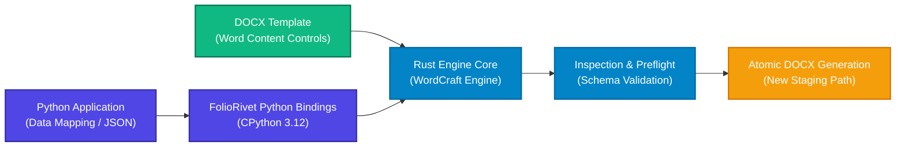

# FolioRivet

**Headless Microsoft Word (DOCX) document generation for Python developers.**

FolioRivet is an independent document-generation engine powered by a high-performance Rust core with native Python 3.12 bindings. It allows developers to populate structured data into standard Microsoft Word templates using native Word Content Controls—without requiring Microsoft Word, LibreOffice, or any desktop office suite installed on the server.

---



---

## Why FolioRivet?

Traditional document automation in Python often forces teams to choose between heavyweight desktop automation (running Microsoft Word or LibreOffice as a background process) and low-level XML manipulation libraries that mangle document styles and require complex programming.

FolioRivet takes a fundamentally different, bounded approach:

- **True Headless Performance**: Document parsing, control resolution, AST modification, and OpenXML serialisation execute in a native Rust core. No background office processes, no GUI dependencies, no COM automation, and no display server requirements.
- **Native Microsoft Word Templates**: Business authors design templates directly in Microsoft Word using standard **Content Controls** on the Developer tab. Word styles, headings, tables, themes, headers, and footers remain intact.
- **Fail-Fast Inspection & Preflight**: Catch template errors, missing fields, typoed paths, and broken asset links in Python before touching disk or producing corrupt documents.
- **Staging Safety & Immutability**: Every render uses a fresh, isolated document session. Templates are treated as strictly immutable inputs, and rendering refuses to overwrite existing files, ensuring zero risk of accidental data destruction.
- **Zero Business Logic in the Engine**: FolioRivet does not evaluate arbitrary programming expressions or invent calculation rules. Numerical aggregation, formatting, currency conversion, and business rules remain entirely where they belong: in your Python application code.

---

## Key Capabilities

FolioRivet 0.1.0a1 supports five bounded template operation families:

| Operation | Word Control | Target Syntax | Python Input | Behavior |
|:---|:---|:---|:---|:---|
| **Scalar Values** | Plain / Rich Text | `value:path.to.key` | `str`, `int`, `float`, `bool` | In-place text substitution preserving font styles and run properties. |
| **Table Rows** | Rich Text Row Wrapper | `rows:table_key` | `list[dict[str, Any]]` | Duplicates a non-header prototype row; inner fields use `value:item.*`. |
| **Inline Pictures** | Picture Control | `image:slot_key` | `{"path": "rel/path.png"}` | Fits image into bounding box preserving aspect ratio; supports optional fallback text. |
| **Repeating Blocks** | Rich Text Block Wrapper | `repeat:block_key` | `list[dict[str, Any]]` | Duplicates entire sections containing headings, paragraphs, tables, and images. |
| **Conditional Blocks** | Rich Text Block Wrapper | `if:condition_key` | `bool` | Retains section when `True`; cleanly removes section when `False`. |

---

## A Quick Taste

Here is the complete workflow to inspect, preflight, and render a document using the FolioRivet Python SDK:

```python
from pathlib import Path
from foliorivet import inspect_template, preflight_template, render_template

template_path = Path("templates/invoice.docx")
assets_dir = Path("templates/assets")
output_path = Path("staging/invoice-2026-001.docx")

# 1. Inspect the template structure and discover required targets
inspection = inspect_template(template_path)
print(f"Discovered {len(inspection['targets'])} template targets.")

# 2. Prepare structured data in Python
context = {
    "customer": "Acme Innovations Ltd",
    "quote_id": "INV-2026-001",
    "lines": [
        {"description": "Design Consultation", "quantity": 4, "unit_price": "£150.00", "amount": "£600.00"},
        {"description": "Implementation Sprint", "quantity": 10, "unit_price": "£850.00", "amount": "£8,500.00"}
    ],
    "subtotal": "£9,100.00",
    "tax": "£1,820.00",
    "total": "£10,920.00"
}

# 3. Preflight data against template targets and assets
summary = preflight_template(template_path, context, assets_dir=assets_dir)
print(f"Preflight passed: {summary['scalar_count']} scalars, {summary['row_count']} rows.")

# 4. Atomically render the populated document to a new staging file
output_path.parent.mkdir(parents=True, exist_ok=True)
rendered_path = render_template(
    template_path=template_path,
    context_json=context,
    assets_dir=assets_dir,
    output_path=output_path
)
print(f"Successfully generated: {rendered_path}")
```

---

## Documentation Roadmap

- **[Getting Started](getting-started/index.md)**: Install the qualified 0.1.0a1 wheel on Windows or Ubuntu, walk through the 5-minute quickstart, and learn how to create your very first template in Microsoft Word.
- **[Concepts](concepts/index.md)**: Understand the document model, template syntax conventions, data scoping, preflight mechanics, and atomic write guarantees.
- **[API Reference](api/index.md)**: Authoritative parameter-by-parameter reference for `render_template`, `inspect_template`, `preflight_template`, and `TemplateError`.
- **[Examples](examples/index.md)**: In-depth walkthroughs of official synthetic examples: Training Evaluation, Invoice Quotation, and Project Status.
- **[Reference](reference/compatibility.md)**: Platform support matrix, OOXML fidelity boundaries, known limitations, and troubleshooting guides.
