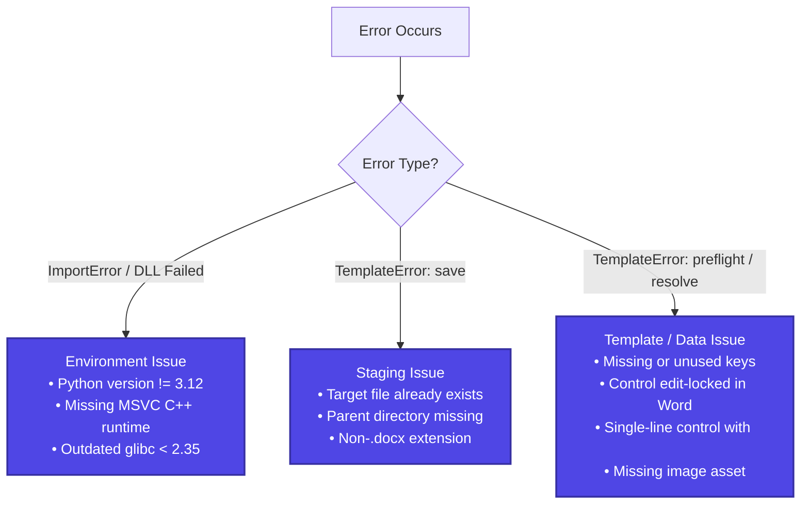

# Troubleshooting

This guide provides troubleshooting steps and root-cause explanations for common errors encountered when using FolioRivet 0.1.0.

---

## Diagnostic Flowchart



---

## Common Error Messages and Solutions

### 1. File Exists / Staging Error

```text
TemplateError: save: target="staging/doc.docx", scope=document: choose a new staging path with an existing parent directory: The file exists. (os error 80)
```

- **Root Cause**: FolioRivet enforces `create_new(true)` to prevent accidental file overwrites.
- **Solution**:
  - Delete or rename the existing file before calling `render_template`.
  - Use unique filenames (e.g. including timestamps or UUIDs).
  - Review [Recipe 1: Atomic File Generation](../examples/recipes.md#recipe-1-atomic-file-generation-with-overwrite-protection).

---

### 2. Parent Directory Does Not Exist

```text
TemplateError: save: target="staging/sub/doc.docx", scope=document: choose a new staging path with an existing parent directory: The system cannot find the path specified. (os error 3)
```

- **Root Cause**: The directory containing your output file has not been created yet.
- **Solution**: Call `output_path.parent.mkdir(parents=True, exist_ok=True)` in Python before calling `render_template`.

---

### 3. Missing Required Value

```text
TemplateError: preflight: target="value:client.name", scope=document: missing required value; supply this dotted field in context
```

- **Root Cause**: The Word template declared a target `value:client.name`, but the context dictionary did not contain a matching `"client"` object with a `"name"` key.
- **Solution**: Verify your context dictionary structure against the template's declared targets using `inspect_template`.

---

### 4. Unused Input Field in Context

```text
TemplateError: preflight: target="value:client.extra_field", scope=document: missing required target; add this tag to the template or remove the unused input field
```

- **Root Cause**: Your context dictionary contained `"extra_field"` under `"client"`, but no matching `value:client.extra_field` tag exists in the template.
- **Solution**: Remove the unmapped field from your context, or add the corresponding control to your Word template.

---

### 5. Multiline Text in Single-Line Control

```text
TemplateError: preflight: target="value:address", scope=document: enable multiline on this plain text control to insert line breaks
```

- **Root Cause**: The string value contains newline characters (`\n`), but the target control in Microsoft Word is a single-line Plain Text control.
- **Solution**: In Microsoft Word:
  1. Select the content control.
  2. Click **Developer** > **Properties**.
  3. Check **Allow carriage returns (multiple paragraphs)**.
  4. Alternatively, replace the control with a **Rich Text Content Control**.

---

### 6. Edit-Locked Content Control

```text
TemplateError: preflight: target="value:invoice_id", scope=document: unlock the control contents before population
```

- **Root Cause**: In Word, the control's properties have **Contents cannot be edited** checked.
- **Solution**: Open the control's Properties dialogue in Word and uncheck **Contents cannot be edited**.

---

### 7. Missing or Invalid Image Asset

```text
TemplateError: preflight: target="image:chart", scope=document: required asset "figures/chart.png" is missing or unreadable
```

- **Root Cause**: The relative image path does not exist inside `assets_dir`.
- **Solution**: Verify that `assets_dir` points to the correct directory and that the asset file was written before preflight. If the image is optional, pass `{"path": null, "required": false, "unavailable": "..."}`.

---

### 8. `ImportError: DLL load failed while importing _native` (Windows)

- **Root Cause**: Missing MSVC runtime libraries on the host machine.
- **Solution**: Install the official [Microsoft Visual C++ Redistributable (x64)](https://aka.ms/vs/17/release/vc_redist.x64.exe).
